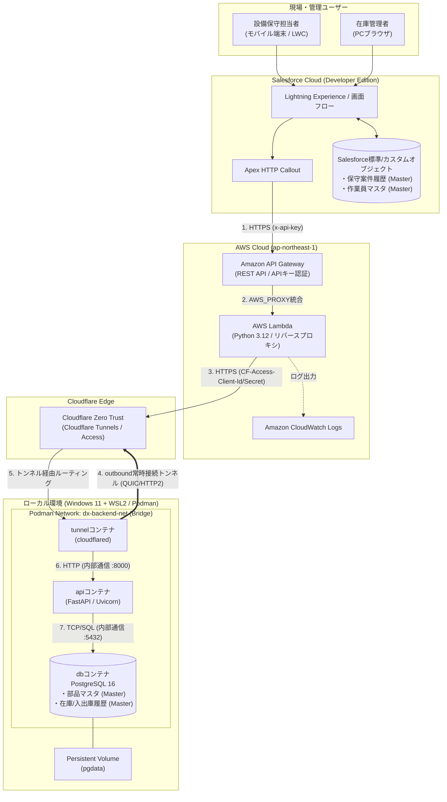
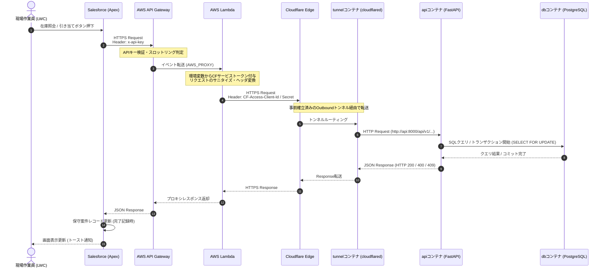

# インフラ・バックエンド基本設計書

## プロジェクト概要

* **テーマ**: 物流倉庫の設備保守・部品在庫管理DX（個人開発ケーススタディ）  
* **体制**: 2名  
* **主目的**: 物流倉庫における設備保守業務および部品の在庫管理業務をデジタル化し、保守作業の効率化と在庫の正確な把握を実現する。

---

## 1.1. システム全体構成図

Salesforce（SaaS）、AWS（パブリッククラウド）、Cloudflare（エッジネットワーク）、およびローカル環境（オンプレミス見立てのWSL2 / Podman）を連携させたハイブリッド構成図です。

&nbsp;

---

## 1.2. ネットワークおよび通信フロー設計

Salesforceでの操作からローカルPostgreSQLのトランザクション完了までの通信シーケンスおよびプロトコル設計です。

&nbsp;

### 通信仕様の要件

1. **タイムアウト設計**:  
   * Salesforce Apex Calloutの上限（デフォルト10秒、最大120秒）およびAPI Gatewayの上限（29秒）を考慮し、**API Gateway / Lambdaのタイムアウトは `10秒`**、**Apex側のタイムアウトは `15秒`** に設定する。  
2. **べき等性（Idempotency）の担保**:  
   * ネットワーク遅延や通信切断・リトライによる二重引き当てを防止するため、Salesforce側から引き当て要求を送信する際は「保守案件番号＋明細ID（またはUUID）」を `idempotency_key` としてペイロードに含め、ローカルDB側で重複実行を検知・ブロックする。

---

## 1.3. 技術スタック選定理由とコスト試算

### 技術スタック選定理由

| レイヤー | 採用技術 | 選定理由（アーキテクト視点） |
| :---- | :---- | :---- |
| **フロント / CRM** | Salesforce Developer Edition (LWC / Flow) | 保守案件のワークフロー、モバイル対応（Salesforce Mobile App）、ユーザー認証基盤をゼロから開発せず標準機能で高速に構築可能。 |
| **APIゲートウェイ** | Amazon API Gateway (REST API) | `x-api-key` と使用量プラン（Usage Plan）によるレートリミット機能をマネージドで提供でき、不正な大量リクエストによる課金爆発を防止できるため。 |
| **中継コンピュート** | AWS Lambda (Python 3.12) | サーバーレスにより待機コストがゼロ。SalesforceとCloudflare間の認証ヘッダ変換、ログ記録、将来的なデータ変換処理のバッファとして機能。 |
| **トンネリング** | Cloudflare Tunnels (`cloudflared`) | ローカル環境（自宅や倉庫内NW）のルーターで**ポート開放や固定グローバルIPの契約が一切不要**。アウトバウンド通信のみでセキュアに公開可能。 |
| **コンテナ基盤** | WSL2 \+ Podman (`podman-compose`) | Docker Desktopの商用ライセンス制限を回避しつつ、デーモンレスかつRootlessでセキュアにDocker互換のコンテナ環境を構築可能。 |
| **バックエンドAPI** | **FastAPI (Python 3.12)** | Lambda（Python）と言語を統一でき2名体制でのスイッチングコストが低い。Pydanticによる厳格な型検証と、自動生成されるSwagger UIによりSalesforce担当者とAPI仕様を共有しやすいため。 |
| **データベース** | PostgreSQL 16 | 行ロック（`SELECT ... FOR UPDATE`）など堅牢なトランザクション分離レベルを備え、在庫引き当て時の競合（レースコンディション）を確実に防げるため。 |

### コスト試算（月額）

| サービス名 | 利用プラン / リソース | 無料枠の適用範囲 | 想定利用量（2名・検証/小規模運用） | 試算コスト |
| :---- | :---- | :---- | :---- | :---- |
| **Salesforce** | Developer Edition | 永続無料（ストレージ上限: データ5MB / ファイル20MB） | 数千レコード規模 | **\$0 / 月** |
| **AWS API Gateway** | REST API | 12ヶ月間無料（月100万コールまで） ※無料枠終了後も100万コールあたり\$3.50 | 約 5,000 コール / 月 | \*\*$0/月** (期間終了後も約$0.02) |
| **AWS Lambda** | ARM64 / 128MBメモリ | **永続無料枠**：月100万リクエスト、40万GB-秒 | 約 5,000 リクエスト / 月 | **\$0 / 月** |
| **CloudWatch Logs** | ログ保存 | **永続無料枠**：月5GBまでの取り込み・保存 | 約 50MB / 月（保持期間14日設定） | **\$0 / 月** |
| **Cloudflare** | Zero Trust Free Plan | **永続無料枠**：50ユーザーまで、Tunnel利用無制限 | 2名、Tunnel 1本 | **\$0 / 月** |
| **独自ドメイン** | Cloudflare Registrar等 | ※Cloudflare Tunnel利用にドメインが1つ必要 | `.com` や `.dev` 等 1ドメイン | **約 \$10 / 年** (月換算 約120円) |
| **ローカル環境** | WSL2 \+ Podman | 既存PCリソースを活用 | コンテナ3台稼働 | **\$0 / 月** |

---

## 1.4. セキュリティ設計方針

「パブリッククラウドからローカル環境への通信」におけるリスクを極小化するため、\*\*多層防御（Defense in Depth）\*\*を採用します。

1. **経路の暗号化とインバウンドポートの完全閉鎖**  
   * ローカル環境（WSL2/ルーター）のインバウンドポートは一切開放しない。`cloudflared` コンテナからCloudflareエッジへ向かうアウトバウンド通信（TLS暗号化）のみでトンネルを確立する。  
2. **多段階の認証・認可（3段階認証）**  
   * **第1段階（Salesforce ➔ API Gateway）**: Salesforceの「指定ログイン情報（Named Credentials）」にAPIキーを格納し、リクエストヘッダ `x-api-key` でAPI Gatewayが認証。  
   * **第2段階（Lambda ➔ Cloudflare）**: Cloudflare Tunnelのエンドポイントがインターネットに露出して直接叩かれるのを防ぐため、**Cloudflare Access（Service Auth / Service Token）** を有効化。Lambdaが `CF-Access-Client-Id` と `CF-Access-Client-Secret` ヘッダを付与した場合のみCloudflareエッジを通過可能とする。  
   * **第3段階（Cloudflare ➔ FastAPI）**: Lambda〜FastAPI間で共有シークレット（`X-Internal-Token`）を検証し、万が一のトンネル設定ミス時もAPIレベルで不正リクエストを拒否する。  
3. **ネットワーク分離（コンテナ間通信制御）**  
   * PostgreSQLコンテナはホストOS側にポートを公開せず、Podman内部ブリッジネットワーク（`dx-backend-net`）内の `api` コンテナからのみアクセス可能とする。