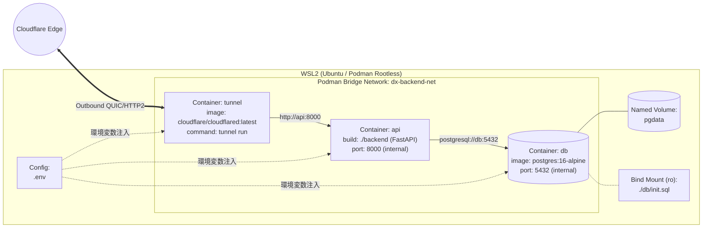
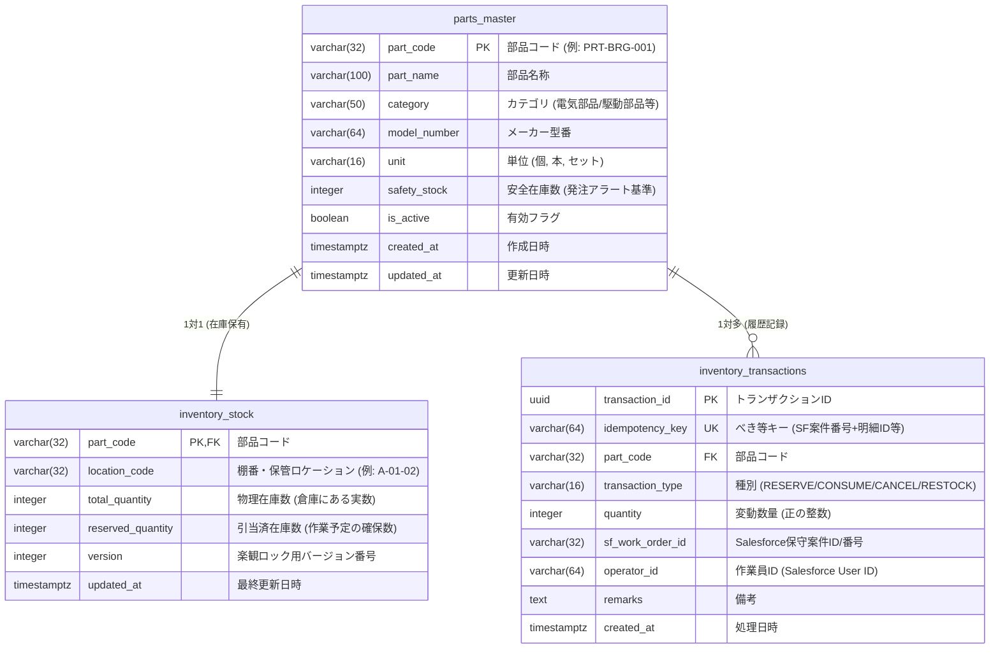

# インフラ・バックエンド詳細設計書

## 2.1. AWS環境設定シート

### (1) Amazon API Gateway 設定仕様
* **APIタイプ**: REST API（リージョンエンドポイント）
* **API名**: `dx-inventory-api`
* **ステージ名**: `v1`
* **スロットリング（使用量プラン）**: レート `10 req/sec`、バースト `20 req`、月間クォータ `10,000 req`（コスト保護）

| リソースパス | メソッド | 統合タイプ | APIキー必須 | 役割・転送先（FastAPIパス） |
| :--- | :--- | :--- | :---: | :--- |
| `/parts` | `GET` | Lambdaプロキシ統合 | Yes (`true`) | 部品一覧・在庫照会 (`GET /api/v1/parts`) |
| `/parts/{part_code}` | `GET` | Lambdaプロキシ統合 | Yes (`true`) | 個別部品の在庫詳細照会 (`GET /api/v1/parts/{part_code}`) |
| `/inventory/reserve` | `POST` | Lambdaプロキシ統合 | Yes (`true`) | 部品の在庫引き当て処理 (`POST /api/v1/inventory/reserve`) |
| `/inventory/consume` | `POST` | Lambdaプロキシ統合 | Yes (`true`) | 作業完了時の部品消費確定 (`POST /api/v1/inventory/consume`) |

---

### (2) AWS Lambda 関数仕様・実装設計
* **関数名**: `dx-inventory-proxy-fn`
* **ランタイム / アーキテクチャ**: Python 3.12 / `arm64` (Graviton2によるコスト・性能最適化)
* **メモリ / タイムアウト**: `128 MB` / `10 秒`
* **環境変数**:
  * `TUNNEL_BASE_URL`: `https://api-inventory.example.com` (Cloudflare Tunnelの公開ホスト名)
  * `CF_ACCESS_CLIENT_ID`: Cloudflare AccessのService Token ID
  * `CF_ACCESS_CLIENT_SECRET`: Cloudflare AccessのService Token Secret
  * `INTERNAL_API_TOKEN`: FastAPI側で検証する内部トークン

#### Lambda プロキシコード構成 (`lambda_function.py`)
外部ライブラリのレイヤー管理を不要にし、コールドスタートを短縮するためにPython標準ライブラリの `urllib.request` で実装します。

```python
import json
import os
import urllib.request
import urllib.error
import urllib.parse

TUNNEL_BASE_URL = os.environ["TUNNEL_BASE_URL"].rstrip("/")
CF_CLIENT_ID = os.environ["CF_ACCESS_CLIENT_ID"]
CF_CLIENT_SECRET = os.environ["CF_ACCESS_CLIENT_SECRET"]
INTERNAL_TOKEN = os.environ["INTERNAL_API_TOKEN"]

def lambda_handler(event, context):
    http_method = event.get("httpMethod", "GET")
    resource_path = event.get("path", "")
    query_params = event.get("queryStringParameters") or {}
    body = event.get("body")

    # API GatewayのパスをFastAPIの /api/v1/... へマッピング
    target_url = f"{TUNNEL_BASE_URL}/api/v1{resource_path}"
    if query_params:
        target_url += "?" + urllib.parse.urlencode(query_params)

    headers = {
        "Content-Type": "application/json",
        "CF-Access-Client-Id": CF_CLIENT_ID,
        "CF-Access-Client-Secret": CF_CLIENT_SECRET,
        "X-Internal-Token": INTERNAL_TOKEN,
        "User-Agent": "AWS-Lambda-Inventory-Proxy/1.0"
    }

    req_data = body.encode("utf-8") if body else None
    req = urllib.request.Request(target_url, data=req_data, headers=headers, method=http_method)

    try:
        with urllib.request.urlopen(req, timeout=8) as res:
            res_body = res.read().decode("utf-8")
            return {
                "statusCode": res.status,
                "headers": {"Content-Type": "application/json"},
                "body": res_body
            }
    except urllib.error.HTTPError as e:
        err_body = e.read().decode("utf-8")
        return {
            "statusCode": e.code,
            "headers": {"Content-Type": "application/json"},
            "body": err_body or json.dumps({"error": "Upstream API Error"})
        }
    except Exception as e:
        return {
            "statusCode": 502,
            "headers": {"Content-Type": "application/json"},
            "body": json.dumps({"error": "Bad Gateway (Tunnel unreachable)", "detail": str(e)})
        }
```

---

### (3) IAM権限設計（最小権限の原則）
* **IAMロール名**: `dx-inventory-lambda-exec-role`
* **信頼ポリシー**: `lambda.amazonaws.com`
* **許可ポリシー**: CloudWatch Logsへの出力権限のみを付与（VPC外Lambdaとしてインターネット経由でCloudflareへ通信するため、余分なAWSリソース権限は一切付与しない）。

```json
{
  "Version": "2012-10-17",
  "Statement": [
    {
      "Effect": "Allow",
      "Action": [
        "logs:CreateLogGroup",
        "logs:CreateLogStream",
        "logs:PutLogEvents"
      ],
      "Resource": "arn:aws:logs:ap-northeast-1:*:log-group:/aws/lambda/dx-inventory-proxy-fn:*"
    }
  ]
}
```

---

## 2.2. Cloudflare Tunnels設定概要

ローカルのPodman環境からCloudflareへ接続する方式として、設定ファイルをローカルで管理しやすい **Remotely-managed Tunnel（トークン方式）** を採用します。

### 設定パラメータ
1. **Tunnelの作成**:
   * Cloudflare Zero Trust ダッシュボード > `Networks` > `Tunnels` にて `dx-warehouse-tunnel` を作成。
   * 発行されたトークン（`TUNNEL_TOKEN`）をローカルの `.env` ファイルに保存。
2. **Public Hostname ルーティング設定**:
   * **Public Hostname**: `api-inventory.<登録ドメイン>`
   * **Service Type**: `HTTP`
   * **URL**: `api:8000` （※Podmanの同一ネットワーク内のサービス名 `api` とポート `8000` を指定）
3. **Cloudflare Access（ゼロトラスト保護）設定**:
   * `Access` > `Service Auth` にてサービストークンを発行し、Lambdaの環境変数に設定。
   * `Access` > `Applications` に `api-inventory.<登録ドメイン>` を登録し、ポリシーアクションを `Service Auth` のみ許可に設定（これによりブラウザ等からの直接アクセスはCloudflareエッジで100%遮断）。

---

## 2.3. コンテナ設計（Podman）

### (1) コンテナネットワーク・ボリューム構成図



### (2) `podman-compose.yml` 定義

```yaml
version: "3.8"

services:
  db:
    image: docker.io/library/postgres:16-alpine
    container_name: dx-postgres
    restart: unless-stopped
    environment:
      POSTGRES_USER: ${POSTGRES_USER:-dxadmin}
      POSTGRES_PASSWORD: ${POSTGRES_PASSWORD}
      POSTGRES_DB: ${POSTGRES_DB:-inventory_db}
      TZ: "Asia/Tokyo"
    volumes:
      - pgdata:/var/lib/postgresql/data
      - ./db/init.sql:/docker-entrypoint-initdb.d/01_init.sql:ro
    networks:
      - dx-backend-net
    # ローカル開発時にDBクライアントから確認する場合のみローカルホスト限定でバインド
    ports:
      - "127.0.0.1:5432:5432"
    healthcheck:
      test: ["CMD-SHELL", "pg_isready -U ${POSTGRES_USER:-dxadmin} -d ${POSTGRES_DB:-inventory_db}"]
      interval: 10s
      timeout: 5s
      retries: 5

  api:
    build:
      context: ./backend
      dockerfile: Containerfile
    container_name: dx-fastapi
    restart: unless-stopped
    environment:
      DATABASE_URL: postgresql+psycopg://${POSTGRES_USER:-dxadmin}:${POSTGRES_PASSWORD}@db:5432/${POSTGRES_DB:-inventory_db}
      INTERNAL_API_TOKEN: ${INTERNAL_API_TOKEN}
      TZ: "Asia/Tokyo"
    depends_on:
      db:
        condition: service_healthy
    networks:
      - dx-backend-net
    # ホスト側へは127.0.0.1のみ公開（Swagger UIでのローカル確認用）
    ports:
      - "127.0.0.1:8000:8000"
    healthcheck:
      test: ["CMD", "python", "-c", "import urllib.request; urllib.request.urlopen('http://localhost:8000/health')"]
      interval: 15s
      timeout: 5s
      retries: 3

  tunnel:
    image: docker.io/cloudflare/cloudflared:latest
    container_name: dx-cloudflared
    restart: unless-stopped
    command: tunnel --no-autoupdate run --token ${TUNNEL_TOKEN}
    depends_on:
      api:
        condition: service_healthy
    networks:
      - dx-backend-net

networks:
  dx-backend-net:
    driver: bridge

volumes:
  pgdata:
```

---

## 2.4. データベース設計（PostgreSQL）

### (1) ER図



### (2) 各テーブルの詳細定義

#### ① 部品マスタテーブル (`parts_master`)

| カラム名 | データ型 | NULL | キー / 制約 | 説明 |
| :--- | :--- | :---: | :--- | :--- |
| `part_code` | `VARCHAR(32)` | NO | **PK** | 部品を一意に識別するコード（バーコード/QR対応想定） |
| `part_name` | `VARCHAR(100)` | NO | - | 部品名称（例：コンベア用深溝玉軸受） |
| `category` | `VARCHAR(50)` | NO | - | 分類（ベアリング、センサー、ベルト等） |
| `model_number` | `VARCHAR(64)` | YES | - | メーカー型番 |
| `unit` | `VARCHAR(16)` | NO | `DEFAULT '個'` | 管理単位（個、本、m、セット） |
| `safety_stock` | `INTEGER` | NO | `DEFAULT 5`, `CHECK (>= 0)` | 安全在庫数（有効在庫がこの値を下回ると要発注表示） |
| `is_active` | `BOOLEAN` | NO | `DEFAULT TRUE` | 廃番・利用停止フラグ |
| `created_at` | `TIMESTAMPTZ` | NO | `DEFAULT NOW()` | レコード作成日時 |
| `updated_at` | `TIMESTAMPTZ` | NO | `DEFAULT NOW()` | レコード更新日時 |

#### ② 在庫テーブル (`inventory_stock`)
引き当て時は `SELECT ... FOR UPDATE` による悲観ロック（行ロック）と、`CHECK` 制約によってマイナス在庫や過剰引き当てをDBエンジンレベルでも防止します。

| カラム名 | データ型 | NULL | キー / 制約 | 説明 |
| :--- | :--- | :---: | :--- | :--- |
| `part_code` | `VARCHAR(32)` | NO | **PK**, **FK** (`parts_master`) | 部品コード |
| `location_code` | `VARCHAR(32)` | NO | - | 倉庫内の棚番（例：`RACK-B-03`）※作業員のピッキング用 |
| `total_quantity` | `INTEGER` | NO | `CHECK (total_quantity >= 0)` | 物理在庫数（現在倉庫に存在する実数） |
| `reserved_quantity` | `INTEGER` | NO | `CHECK (reserved_quantity >= 0 AND reserved_quantity <= total_quantity)` | 引当済在庫数（物理在庫を超える引き当ては不可） |
| `version` | `INTEGER` | NO | `DEFAULT 1` | 更新のたびにインクリメントするバージョン番号 |
| `updated_at` | `TIMESTAMPTZ` | NO | `DEFAULT NOW()` | 最終更新日時 |

> **※有効在庫数（Available Quantity）の算出式**:
> $\text{available\_quantity} = \text{total\_quantity} - \text{reserved\_quantity}$

#### ③ 入出庫・引当トランザクション履歴テーブル (`inventory_transactions`)
誰が・どの保守案件で・いつ・いくつ引き当て/消費したかの監査証跡（Audit Trail）および二重送信防止（べき等性担保）を担います。

| カラム名 | データ型 | NULL | キー / 制約 | 説明 |
| :--- | :--- | :---: | :--- | :--- |
| `transaction_id` | `UUID` | NO | **PK**, `DEFAULT gen_random_uuid()` | トランザクション一意識別子 |
| `idempotency_key` | `VARCHAR(64)` | NO | **UNIQUE** | 二重実行防止キー（例：`WO-00124_RESERVE_1`） |
| `part_code` | `VARCHAR(32)` | NO | **FK** (`parts_master`), **INDEX** | 対象部品コード |
| `transaction_type` | `VARCHAR(16)` | NO | `CHECK (IN ('RESERVE','CONSUME','CANCEL','RESTOCK'))` | 処理種別（引当 / 消費確定 / 引当取消 / 入庫補充） |
| `quantity` | `INTEGER` | NO | `CHECK (quantity > 0)` | 操作数量 |
| `sf_work_order_id` | `VARCHAR(32)` | YES | **INDEX** | Salesforce側の保守案件ID（例：`a005h00000XXXXX`） |
| `operator_id` | `VARCHAR(64)` | NO | - | 操作したSalesforceユーザーのIDまたは社員番号 |
| `remarks` | `TEXT` | YES | - | 備考・理由 |
| `created_at` | `TIMESTAMPTZ` | NO | `DEFAULT NOW()` | 処理実行日時 |

---

## 2.5. APIインターフェース定義

### 共通仕様
* **データ形式**: `application/json; charset=utf-8`
* **日時形式**: ISO 8601 (`YYYY-MM-DDThh:mm:ss+09:00`)
* **共通リクエストヘッダ（Salesforce ➔ API Gateway）**:
  * `x-api-key`: `<API_GATEWAY_API_KEY>`
  * `Content-Type`: `application/json`

---

### (1) 在庫照会API（一覧・検索）
作業員が保守対象設備の交換部品を検索したり、複数部品の現在庫を一括確認する際に使用します。

* **エンドポイント**: `GET /v1/parts` （FastAPI内部パス: `GET /api/v1/parts`）
* **クエリパラメータ**:
  * `category` (任意, string): カテゴリ絞り込み（例：`駆動部品`）
  * `keyword` (任意, string): 部品コードまたは部品名称の部分一致検索
  * `part_codes` (任意, string): カンマ区切りの部品コード指定（例：`PRT-BRG-001,PRT-BLT-002`）

#### レスポンス例 (`200 OK`)
```json
{
  "status": "success",
  "count": 2,
  "items": [
    {
      "part_code": "PRT-BRG-001",
      "part_name": "コンベア用深溝玉軸受 6204ZZ",
      "category": "駆動部品",
      "model_number": "NSK-6204ZZ",
      "unit": "個",
      "location_code": "A-02-01",
      "total_quantity": 15,
      "reserved_quantity": 3,
      "available_quantity": 12,
      "safety_stock": 5,
      "needs_reorder": false,
      "updated_at": "2026-11-01T15:30:00+09:00"
    },
    {
      "part_code": "PRT-BLT-002",
      "part_name": "搬送タイミングベルト S8M-1200",
      "category": "駆動部品",
      "model_number": "MTB-S8M-1200",
      "unit": "本",
      "location_code": "B-01-04",
      "total_quantity": 4,
      "reserved_quantity": 2,
      "available_quantity": 2,
      "safety_stock": 3,
      "needs_reorder": true,
      "updated_at": "2026-11-01T11:10:00+09:00"
    }
  ]
}
```

---

### (2) 在庫引き当てAPI
作業員が保守作業に入る前、必要な部品を他の作業員に取られないよう確保（ロック）するAPIです。
DB内部では `inventory_stock` テーブルの対象行を `SELECT ... FOR UPDATE` でロックし、`available_quantity >= 要求数` を確認した上で `reserved_quantity` を加算します。

* **エンドポイント**: `POST /v1/inventory/reserve` （FastAPI内部パス: `POST /api/v1/inventory/reserve`）

#### リクエストペイロード例
```json
{
  "idempotency_key": "WO-20261101-001_PRT-BRG-001_RSV",
  "sf_work_order_id": "a015h000009XYZ1AAO",
  "operator_id": "0055h000004ABC2AAO",
  "part_code": "PRT-BRG-001",
  "quantity": 2,
  "remarks": "第2ライン仕分けコンベア異音対応のため引当"
}
```

#### レスポンス例（正常時: `200 OK`）
```json
{
  "status": "success",
  "message": "在庫の引き当てが完了しました。",
  "transaction": {
    "transaction_id": "c9a646d3-9c61-4cb7-bfcd-825f282a6b11",
    "transaction_type": "RESERVE",
    "idempotency_key": "WO-20261101-001_PRT-BRG-001_RSV",
    "part_code": "PRT-BRG-001",
    "reserved_now": 2,
    "stock_after": {
      "location_code": "A-02-01",
      "total_quantity": 15,
      "reserved_quantity": 5,
      "available_quantity": 10
    },
    "processed_at": "2026-11-01T17:45:12+09:00"
  }
}
```

#### レスポンス例（在庫不足エラー時: `409 Conflict`）
```json
{
  "status": "error",
  "error_code": "INSUFFICIENT_AVAILABLE_STOCK",
  "message": "有効在庫数が不足しているため引き当てできません。",
  "detail": {
    "part_code": "PRT-BRG-001",
    "requested_quantity": 2,
    "available_quantity": 1,
    "total_quantity": 15,
    "reserved_quantity": 14
  }
}
```

---

### (3) 部品消費確定API（作業完了記録時）
作業完了時に引き当てていた在庫を実消費として確定させ、`total_quantity`（物理在庫）と `reserved_quantity`（引当済数）の両方を減算します。

* **エンドポイント**: `POST /v1/inventory/consume` （FastAPI内部パス: `POST /api/v1/inventory/consume`）

#### リクエストペイロード例
```json
{
  "idempotency_key": "WO-20261101-001_PRT-BRG-001_CSM",
  "sf_work_order_id": "a015h000009XYZ1AAO",
  "operator_id": "0055h000004ABC2AAO",
  "part_code": "PRT-BRG-001",
  "quantity": 2,
  "remarks": "作業完了に伴う部品消費確定"
}
```

#### レスポンス例（正常時: `200 OK`）
```json
{
  "status": "success",
  "message": "部品の消費確定（出庫処理）が完了しました。",
  "transaction": {
    "transaction_id": "f47ac10b-58cc-4372-a567-0e02b2c3d479",
    "transaction_type": "CONSUME",
    "part_code": "PRT-BRG-001",
    "consumed_quantity": 2,
    "stock_after": {
      "total_quantity": 13,
      "reserved_quantity": 3,
      "available_quantity": 10,
      "needs_reorder": false
    },
    "processed_at": "2026-11-01T18:20:00+09:00"
  }
}
```

---

### (4) エラーコード一覧（API共通）

| HTTPステータス | `error_code` | 発生条件 | Salesforce (LWC) 側での表示・推奨アクション |
| :---: | :--- | :--- | :--- |
| `400 Bad Request` | `VALIDATION_ERROR` | 数量が0以下、必須項目欠落など | 入力内容を確認してください（数量は1以上で指定してください）。 |
| `401 Unauthorized` | `UNAUTHORIZED` | APIキーまたは内部トークン不一致 | システム認証エラーが発生しました。管理者に連絡してください。 |
| `404 Not Found` | `PART_NOT_FOUND` | 指定された `part_code` が存在しない | 指定された部品コードはマスタに登録されていません。 |
| `409 Conflict` | `INSUFFICIENT_AVAILABLE_STOCK` | 要求数 ＞ 有効在庫数 | 在庫が不足しています（現在庫を確認してください）。 |
| `409 Conflict` | `DUPLICATE_TRANSACTION` | 同一の `idempotency_key` で異なる内容を送付 | 既に処理済みのリクエストです。画面を再読み込みしてください。 |
| `502 Bad Gateway` | `UPSTREAM_UNAVAILABLE` | ローカルPC/Podman停止、Tunnel切断 | 倉庫内の在庫サーバーに接続できません。稼働状況を確認してください。 |

