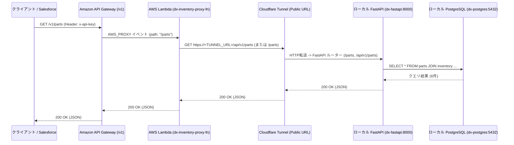

# Cloudflare Tunnel・AWS結合疎通手順書

本ドキュメントは、ローカル環境（WSL2 + Podman）上のFastAPIサーバーを **Cloudflare Tunnels (`cloudflared`)** を介して外部へセキュアに公開し、**Amazon API Gateway ➔ AWS Lambda ➔ Cloudflare Tunnel ➔ ローカルFastAPI ➔ ローカルPostgreSQL** の一気通貫（End-to-End）疎通を行うための構築・運用手順書です。

---

## 1. 全体通信経路とルーティングマッピング



---

## 2. Cloudflare Tunnel の起動方法

用途に応じて「① クイックトンネル（一時URL・検証用）」または「② 名前付きトンネル（独自ドメイン・常時運用）」の2通りが利用可能です。

### 方法①：Quick Tunnel（ドメイン不要・即時検証用）
Cloudflareアカウントや独自ドメインがなくても、`trycloudflare.com` の一時公開URLを発行して即座にAWS Lambdaと結合検証を行う方法です。

```bash
# WSL2上でローカルのポート8000番（FastAPI）に対するQuick Tunnelを起動
podman run --rm -it --network deploy_dx-backend-net \
  docker.io/cloudflare/cloudflared:latest \
  tunnel --url http://dx-fastapi:8000
```
* 起動ログに表示される `https://xxxx-xxxx-xxxx.trycloudflare.com` のURLをコピーし、AWS Lambdaの環境変数 `TUNNEL_BASE_URL` に設定します。

### 方法②：Named Tunnel（トークン方式・常時運用）
Cloudflare Zero Trustダッシュボードで発行した `TUNNEL_TOKEN` を使用して、`podman-compose.yml` の `tunnel` サービスとしてバックグラウンド常駐させる方法です。

1. `deploy/.env.example` をコピーして `deploy/.env` を作成し、`TUNNEL_TOKEN` を記述します。
2. Public Hostname の転送先サービスURLを `http://api:8000`（または `http://dx-fastapi:8000`）に設定します。
3. 以下のコマンドで `tunnel` プロファイルを含めて起動します。
   ```bash
   cd "/mnt/g/マイドライブ/個人開発/ハイブリッドDX基盤構築プロジェクト/deploy"
   podman-compose --profile tunnel up -d
   ```

---

## 3. AWS Lambda 側の環境変数設定

AWSマネジメントコンソールの `dx-inventory-proxy-fn` 関数の「設定」＞「環境変数」にて、トンネルURLを設定します。

| 環境変数キー | 設定値の例 | 注意事項 |
| :--- | :--- | :--- |
| `TUNNEL_BASE_URL` | `https://xxxx.trycloudflare.com`<br/>または `https://api-inventory.yourdomain.com` | **末尾に `/`（スラッシュ）を付けないこと** |
| `CF_ACCESS_CLIENT_ID` | Cloudflare Access利用時のみ設定 | 未使用時は空欄またはダミー値で可 |
| `CF_ACCESS_CLIENT_SECRET` | Cloudflare Access利用時のみ設定 | 未使用時は空欄またはダミー値で可 |
| `INTERNAL_API_TOKEN` | `dx-warehouse-secure-token-2026` | 内部認証トークン |

---

## 4. End-to-End 結合テスト手順

ローカルの `dx-postgres`、`dx-fastapi`、および `cloudflared` が起動している状態で、AWS API Gatewayのエンドポイントに対してリクエストを送信します。

### 4.1. 全部品一覧の取得 (`GET /v1/parts`)
```bash
curl -X GET "https://<API-ID>.execute-api.ap-northeast-1.amazonaws.com/v1/parts" \
  -H "x-api-key: <API_GATEWAY_API_KEY>"
```
* **期待される結果**: ローカルPostgreSQLに格納されている6件の部品在庫JSONが `200 OK` で返却されること。

### 4.2. 個別部品の在庫照会 (`GET /v1/parts/{part_id}`)
```bash
curl -X GET "https://<API-ID>.execute-api.ap-northeast-1.amazonaws.com/v1/parts/PRT-002" \
  -H "x-api-key: <API_GATEWAY_API_KEY>"
```
* **期待される結果**: `PRT-002`（光電センサー）の在庫情報が `200 OK` で返却されること。

### 4.3. 在庫引き当ての実行 (`POST /v1/inventory/reserve`)
```bash
curl -X POST "https://<API-ID>.execute-api.ap-northeast-1.amazonaws.com/v1/inventory/reserve" \
  -H "x-api-key: <API_GATEWAY_API_KEY>" \
  -H "Content-Type: application/json" \
  -d '{
    "part_id": "PRT-002",
    "allocate_quantity": 1,
    "work_order_id": "WO-AWS-E2E-001"
  }'
```
* **期待される結果**: `"status": "success"` とともに、`remaining_quantity` が1減算されたレスポンスが返却されること。

---

## 5. トラブルシューティング（よくあるエラーと対処法）

| ステータスコード | 症状・エラー内容 | 主な原因と解決策 |
| :---: | :--- | :--- |
| `403 Forbidden` | `{"message": "Forbidden"}` | リクエストヘッダ `x-api-key` が未指定、またはAPIキーが使用量プラン（Usage Plan）およびステージ `v1` に紐付いていない。 |
| `404 Not Found` | `{"detail": "Not Found"}` | FastAPI側のルーティングとLambdaの転送先パスが不一致。`podman rm -f dx-fastapi && podman-compose up -d api` で最新コードを反映させる。 |
| `502 Bad Gateway` | `Bad Gateway (Tunnel unreachable)` | ローカルの `cloudflared` または `dx-fastapi` が停止している、あるいはQuick Tunnel再起動後にLambdaの環境変数 `TUNNEL_BASE_URL` を更新していない。 |
| `504 Gateway Timeout` | エンドポイントタイムアウト | Lambdaのタイムアウト設定がデフォルト（3秒）のままになっている。Lambdaの一般設定でタイムアウトを `10秒` に変更する。 |
