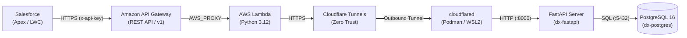

# 物流倉庫 設備保守・部品在庫管理DX プロジェクト (Infrastructure & Backend)

物流倉庫における設備保守業務および部品の在庫管理業務をデジタル化し、保守作業の効率化と在庫の正確な把握を実現するハイブリッドDX基盤のインフラ・バックエンドリポジトリです。

---

## 📌 現在の構築ステータス

* ✅ **基本設計・詳細設計**: アーキテクチャ設計・DB設計・APIインターフェース定義 完了
* ✅ **ローカルDB・API基盤 (WSL2 + Podman)**: PostgreSQL 16 + FastAPI コンテナ構築・初期データ投入・単体疎通 完了
* ✅ **クラウド中継基盤 (AWS + Cloudflare)**: Amazon API Gateway + AWS Lambda + Cloudflare Tunnels によるクラウド〜ローカル間のEnd-to-End疎通 完了
* 🔜 **次フェーズ**: Salesforce (Apex Callout / LWC / Flow) からの結合連携およびトランザクション拡張

---

## 🏗 アーキテクチャ概要



---

## 📁 ディレクトリ構成

```text
warehouse-infra-backend/
├── .github/
│   └── workflows/
│       └── auto-assign.yml                     # Issue / PR 自動アサインワークフロー
├── 00.管理/                                    # WBS、作業ログ等（※.gitignoreによりGit管理外）
├── 01.基本設計書/
│   └── インフラ・バックエンド基本設計書.md     # 全体構成図・通信シーケンス・コスト試算・セキュリティ方針
├── 02.詳細設計書/
│   └── インフラ・バックエンド詳細設計書.md     # AWS・Cloudflare・コンテナ・DB・API詳細仕様
├── 03.構築・運用手順書/
│   ├── AWS環境構築手順書.md                    # IAM / Lambda / API Gateway セットアップ手順
│   ├── ローカル環境構築・APIテスト手順書.md    # WSL2 + Podman 起動・ローカルAPIテスト手順
│   └── Cloudflare_Tunnel・AWS結合疎通手順書.md # トンネル接続およびAWS経由E2E疎通確認手順
├── 99.docs/                                    # 参考資料・プロジェクト概要PDF
├── deploy/                                     # コンテナオーケストレーション定義
│   ├── podman-compose.yml                      # Podman Compose 設定 (db, api, tunnel)
│   └── .env.example                            # 環境変数テンプレート
├── src/                                        # ソースコード資材
│   ├── aws/
│   │   └── lambda_function.py                  # AWS Lambda リバースプロキシ関数
│   ├── backend/
│   │   ├── Dockerfile                          # FastAPI コンテナイメージ定義
│   │   ├── main.py                             # FastAPI アプリケーション本体
│   │   └── requirements.txt                    # Python 依存ライブラリ定義
│   ├── db/
│   │   └── init.sql                            # PostgreSQL テーブル定義 (DDL) & 初期データ (DML)
│   └── salesforce/                             # Salesforce連携用サンプル・補助資材
├── .gitignore
└── README.md
```

---

## 🛠 技術スタック

| レイヤー | 技術要素 | 用途・役割 |
| :--- | :--- | :--- |
| **APIゲートウェイ** | Amazon API Gateway (REST API) | エンドポイント公開、`x-api-key` 認証、使用量プランによるレート制限 |
| **リバースプロキシ** | AWS Lambda (Python 3.12 / ARM64) | API Gatewayからのイベント受け取り、Cloudflare Tunnelへのセキュア転送 |
| **トンネリング** | Cloudflare Tunnels (`cloudflared`) | ローカル側ルーターのポート開放なしでのセキュアなアウトバウンドトンネル接続 |
| **コンテナ基盤** | WSL2 + Podman (`podman-compose`) | ローカル環境でのRootlessコンテナオーケストレーション |
| **バックエンドAPI** | FastAPI (Python 3.12 / Uvicorn / Pydantic) | 在庫照会・引き当て処理、リクエスト/レスポンス型検証、OpenAPI自動生成 |
| **データベース** | PostgreSQL 16 (Alpine) | 部品マスタ（`parts`）・在庫（`inventory`）管理、行ロック（`SELECT ... FOR UPDATE`）による排他制御 |

---

## 🔌 バックエンドAPI エンドポイント一覧

ローカル直接アクセス用のパスと、AWS API Gateway / Lambda プロキシ経由用のパス（エイリアス）の両方に対応しています。

| 機能 | HTTPメソッド | ローカルパス | AWS連携パス（エイリアス） | 説明 |
| :--- | :---: | :--- | :--- | :--- |
| **ヘルスチェック** | `GET` | `/health` | - | コンテナ死活監視用 (`{"status": "ok"}`) |
| **部品在庫一覧取得** | `GET` | `/api/inventory` | `/parts`<br/>`/api/v1/parts` | 全登録部品のマスタ情報・現在庫数・発注アラート判定を一括取得 |
| **個別部品在庫照会** | `GET` | `/api/inventory/{part_id}` | `/parts/{part_id}`<br/>`/api/v1/parts/{part_id}` | 指定した部品ID（例: `PRT-002`）の詳細情報と現在庫数を取得 |
| **部品在庫引き当て** | `POST` | `/api/inventory/allocate` | `/inventory/reserve`<br/>`/api/v1/inventory/reserve` | 指定数量を現在庫から減算更新（トランザクション・行ロック制御付き） |

---

## 🗄 データベース構成（初期シードデータ）

`src/db/init.sql` により、コンテナ初回起動時に以下の6件の保守部品データが自動投入されます。

| 部品ID (`part_id`) | 部品名称 (`part_name`) | カテゴリ | 型番 (`model_number`) | 棚番 (`location_code`) | 初期在庫数 | 安全在庫数 |
| :--- | :--- | :--- | :--- | :---: | :---: | :---: |
| `PRT-001` | 高強度六角ボルト M12×40 (10本入) | 締結部品 | `SUS304-M12-40` | `A-01-01` | 50 パック | 10 |
| `PRT-002` | 光電センサー (反射型・長距離) | 電気・センサー | `E3Z-D82` | `B-02-03` | 12 個 | 5 |
| `PRT-003` | 搬送コンベア用 三相誘導モーター 0.75kW | 駆動・モーター | `GM-SSYPF-0.75KW` | `C-01-01` | 3 台 | 2 |
| `PRT-004` | 深溝玉軸受 (ベアリング) | 駆動部品 | `6204ZZ` | `A-02-04` | 25 個 | 8 |
| `PRT-005` | 搬送用タイミングベルト | 駆動部品 | `S8M-1200` | `A-03-02` | 6 本 | 3 |
| `PRT-006` | 非常停止用押しボタンスイッチ | 電気・制御 | `XW1E-BV402M-R` | `B-01-02` | 8 個 | 4 |

---

## 🚀 クイックスタートガイド

### 1. ローカルコンテナ（DB + FastAPI）の起動
```bash
cd deploy
podman-compose up -d --build
```
* `src/backend/main.py` はコンテナ内の `/app/main.py` にボリュームマウントされているため、コード変更時はコンテナ再起動のみで即座に反映されます。
* Swagger UI（APIドキュメント）: `http://localhost:8000/docs`

### 2. ローカル疎通確認
```bash
# 全件一覧取得
curl -X GET "http://localhost:8000/parts"

# 個別部品照会 (PRT-002)
curl -X GET "http://localhost:8000/api/v1/parts/PRT-002"

# 在庫引き当て (PRT-002 を 2個引き当て)
curl -X POST "http://localhost:8000/api/v1/inventory/reserve" \
  -H "Content-Type: application/json" \
  -d '{"part_id": "PRT-002", "allocate_quantity": 2, "work_order_id": "WO-20261103-001"}'
```

---

## 📚 関連ドキュメントリンク

* **設計書**
  * [インフラ・バックエンド基本設計書](./01.基本設計書/インフラ・バックエンド基本設計書.md)
  * [インフラ・バックエンド詳細設計書](./02.詳細設計書/インフラ・バックエンド詳細設計書.md)
* **構築・運用手順書**
  * [AWS環境構築手順書](./03.構築・運用手順書/AWS環境構築手順書.md)
  * [ローカル環境構築・APIテスト手順書](./03.構築・運用手順書/ローカル環境構築・APIテスト手順書.md)
  * [Cloudflare Tunnel・AWS結合疎通手順書](./03.構築・運用手順書/Cloudflare_Tunnel・AWS結合疎通手順書.md)
